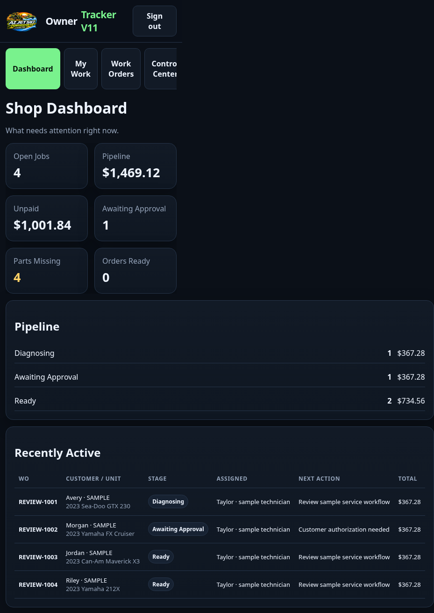

# Shop assessment and UI development plan

Assessment date: October 26, 2026. Application reviewed: `81cd8a1be01f5b9cbc197faa1b53aa69ab64b137`, version `11.1.0-preview.1`.

## Decision

Keep developing this as one shop system. The core features are useful, but the current release should remain a review-only build until the correctness defects below are fixed. Passing the existing automated suite does not establish that every workflow works: additional checks found failures outside its coverage.

Prioritize repair intake through customer pickup, with counter parts sales retained as a separate entry point. This is a working product assumption, not a decision to remove counter sales. Simplification should first change navigation and defaults. Do not delete records, financial history, retained authorizations, or integrations merely because their controls move out of everyday screens.

This assessment changes documentation only. It does not repair the defects listed below or change the running review application.

## Evidence and confidence

| Check | Result | What it establishes |
| --- | --- | --- |
| Fresh full application run on Node 22.23.4 | 76 JavaScript files passed syntax checks; 145 automated tests/subtests passed, zero failures/skips; all included V6/V8/V9/V10/V11 regression scripts passed | Existing unit and HTTP expectations still hold in disposable databases |
| Fresh private review transport tests | 6 passed | Queue claims, authentication, headers, binary transfers, expiry and fixed localhost target work under the tested conditions |
| Additional route-level checks | Reproduced customer-link reassignment exposure, authorization revision gap, partially persisted rejected edits, taxable edit rejection, duplicate/wrong-SKU inventory movements and stale appointment reminders | These are uncovered defects, despite the green existing suite |
| Fresh disposable browser smoke, Chromium at 1440px and 390px | All nine page routes rendered without page-level JavaScript exceptions; eight nonoverview Shop Operations tabs and five Management tabs rendered at both sizes. Main desk money input rejected cents at both sizes; the 390px dashboard expanded to 929px document width | This is browser evidence for navigation/rendering and those failures, not proof every screen's actions work or that Safari/real devices pass |
| Additional isolated UI execution | Actual billing module with DOM/API stubs submitted against the previous job after deselection | API tests do not cover enough actual form behavior |
| Existing GitHub CI, checked again October 26 | [Application/transport/launcher](https://github.com/blockaystudio/AzJetSki-Controller/actions/runs/40169994576), [Windows install/rollback](https://github.com/blockaystudio/AzJetSki-Controller/actions/runs/40169728243), [unsigned iOS builds](https://github.com/blockaystudio/AzJetSki-Controller/actions/runs/40169728283) succeeded | Windows/iOS results are prior CI evidence, not fresh shop-device acceptance; application code is unchanged since those platform checks |
| Actual shop devices, real provider transactions and production recovery | Not established | Printer/drawer, phone camera/network behavior, live email/Calendar, merchant/dealer adapters, real-data migration and offsite recovery still need acceptance |

The full application command was `node Windows-Server/test/run-suite.mjs`; transport command was `node --test review-hosting/test/bridge.test.mjs`, both using Node 22. No real customer messages, purchases, charges or refunds were performed. Legacy API fixtures disable revision requirements; the dedicated launch HTTP test enables strict revisions. Future regressions must exercise strict mode and all active aliases.

## Features to keep, simplify or defer

| Feature area | Recommendation for this shop | Current limitation or next decision |
| --- | --- | --- |
| Customers, multiple vehicles, intake, lot/key custody | Keep as core | Make one guided check-in; fix reassignment and terminal-stage consistency |
| Work orders, estimates, assignments, notes/photos | Keep as core | One job workspace; validate actual form behavior and financial edit atomicity |
| Retained customer authorizations and revised estimates | Keep as core | Preserve exact signed evidence; close revision alias gap; rehearse approval/decline/expiry on phones |
| Customer status/document links | Keep after correction | Bind access to the right customer and revoke on permitted identity corrections |
| Invoices, deposits, split payments, pending Zelle, receipts | Keep as core | One account summary with clear customer due versus refund owed; fix decimals and job selection |
| Credits, refunds, cancellations, original-sale returns | Keep, with role restrictions | Combine their UI under the original transaction; test complete credit/refund/stock sequences |
| Counter parts sales and special orders | Keep | Separate counter-sale entry, shared customer/account components; no invented vehicle required |
| Parts requests, supplier carts, partial receiving, bins/barcodes | Keep the manual workflow | Unify old/new stock entry, enforce retry safety and actual invoice-line/SKU quantities |
| Purchasing limits and independent approvals | Keep as configurable owner policy | Match actual staffing; explain blocked requests; do not weaken backend controls to simplify UI |
| Employee roles, sessions, recovery, concurrent-edit protection | Keep | Role-specific screens; consider a shared “Service advisor” UI label only after reviewing purchasing differences |
| Backups, restore, audit history, release rollback | Keep; owner settings | Permanent storage and a real restore drill remain essential |
| Daily close and basic cashflow/aging reports | Keep | Fix completion timestamps; show data basis and distinguish cashflow from accounting profit |
| Local appointments and ICS export | Keep if the shop schedules service | Improve calendar/reschedule UI; preserve a useful local workflow |
| Service email and appointment reminders | Keep after reliability repairs | Fix SMTP failure handling and stale reminders before enabling automatic sending |
| Google Calendar integration and conflict handling | Optional | Hide setup from daily work; enable only after credentials and live conflict/cancellation checks; inbound synchronization is not established |
| Marketing campaigns, automated follow-ups, advanced attribution | Defer from first-use navigation | Consent storage can remain; completion data and sender acceptance must be reliable first |
| DocuSign alongside built-in retained authorization | Defer unless the shop requires it | Two signing paths add training and provider cost; retain source/history and review wording requirements |
| Automatic merchant charging/hosted payment integration | Defer | Live adapter is not implemented/certified; retain recording of externally verified payments |
| Unattended supplier checkout and automatic sourcing | Defer | Live dealer adapters are incomplete; reviewed manifests do not place an order |
| Native owner and technician iOS distribution | Defer | Focus first on responsive mobile web; simulator builds do not establish signed distribution or feature parity |
| Legacy QuickBooks POS import/synchronization | Hide unless needed for migration | Confirm the shop's actual source data before investing in ongoing synchronization |
| Raw JSON imports, numeric record IDs, manual approval target JSON | Move to restricted setup/diagnostics; replace common flows with selectors | These are implementation details, not a usable daily workflow |
| Fleet programs, public product pages, advanced marketing ROI, labor time/QC, warranty/core/vendor-credit matching | Separate future backlog | The original long-term plan is not proof these features are complete; prioritize only against an actual shop need |

## Defects to resolve before shop use

P0 means a release blocker for customer privacy. P1 means a release blocker for data, money or essential workflow reliability. P2 means functional/UI work required before staff acceptance. Source links refer to the reviewed application; line numbers are recorded for navigation.

| ID / priority | Confirmed finding | Evidence and required outcome |
| --- | --- | --- |
| A01 / P0 | Reassigning a job to another customer leaves the original customer's link valid and displaying the new customer/unit | Actual-router reproduction. [pos-extension.mjs](../Windows-Server/src/pos-extension.mjs), lines 195–197; [customer-access.mjs](../Windows-Server/src/customer-access.mjs), lines 39–48. Restrict identity changes after documents/history exist; permitted corrections must atomically revoke or invalidate old access and preserve history |
| A02 / P1 | A rejected repair-line edit can persist the changed line while leaving old totals | Reproduced $100 line with $80 credit edited to $50: HTTP 409, stored line $50, job total $100. [pos-extension.mjs](../Windows-Server/src/pos-extension.mjs), lines 235–242. Validate complete prospective totals and commit line, parts, totals and audit in one transaction; rejection must change nothing |
| A03 / P1 | Old inventory adjustment route duplicates stock on retry and accepts an unrelated invoice/SKU combination | Same receipt/key twice produced two movements; unrelated invoice accepted for stock sale. [shop-ops.mjs](../Windows-Server/src/shop-ops.mjs), lines 359–372. Use one idempotent ledger with exact invoice-line/SKU/quantity or receipt linkage; retire overlapping write paths |
| A04 / P1 | SMTP connection errors escape the promise and can terminate the server; timeout logic cannot reject correctly | Isolated child process reproduced unhandled socket failure; waiter identity error confirmed in source. [shop-mail.mjs](../Windows-Server/src/shop-mail.mjs), lines 14–20. Handle error/close/timeout once, preserve outbox state and classify uncertain acceptance without automatic duplicate sends |
| A05 / P1 | Billing deselection leaves a previous job active for invoice/signature actions | Actual billing module executed with DOM/API stubs: clearing selection then submitting still posted to previous job. [billing.js](../Windows-Server/public/billing.js), lines 8 and subsequent submit handlers. Clear job, amounts and controls immediately; disable actions until the current selection finishes loading; ignore stale responses |
| A06 / P1 | Cancelled or rescheduled appointments can retain sendable reminders for the old appointment | Isolated actual-router/outbox reproduction dispatched a queued reminder after cancellation using a mock sender. [service-notifications.mjs](../Windows-Server/src/service-notifications.mjs), lines 67–75; [shop-management.mjs](../Windows-Server/src/shop-management.mjs), lines 411–420. Bind reminders to appointment ID/revision; cancel or replace them on change and recheck before dispatch |
| A07 / P1 | General stage edits can mark a job Picked Up/Closed without the official checkout transition | Source-confirmed in [server.mjs](../Windows-Server/src/server.mjs), line 337 and POS PATCH. Official physical checkout still enforces payment; the defect is contradictory job/lot/account state and jobs disappearing from active queues. Route terminal stages through one role-checked operation; preserve diagnosis without demanding repair approval |
| A08 / P1 | Main desk amount fields omit decimal step and reject cents | Browser confirmed `100.50` fails native validation with step mismatch. [app.js](../Windows-Server/public/app.js), field helper at line 59 and its number-field consumers. Use appropriate decimal input rules for money and quantities; verify keyboard/mobile behavior |
| A09 / P2 | Fully paid taxable jobs reject a description-only line edit | Actual router: $100 subtotal + $9.10 tax, $109.10 paid, description edit returns 409 because pretax subtotal is compared with tax-inclusive paid amount. [pos-extension.mjs](../Windows-Server/src/pos-extension.mjs), line 234. Use consistent integer-cent, tax-inclusive account calculations |
| A10 / P1 | Alternate authorization creation route misses strict revision protection | Actual routes: creation through `/authorizations` accepts no revision while `/request-approval` returns 428. [authorizations.mjs](../Windows-Server/src/authorizations.mjs), line 305; [edit-revisions.mjs](../Windows-Server/src/edit-revisions.mjs), line 69. Both paths must enforce the same version |
| A11 / P2 | Normal pickup omits the completion date used by cycle-time and retention reports | Source-confirmed: [shop-ops.mjs](../Windows-Server/src/shop-ops.mjs), line 178 versus [shop-reports.mjs](../Windows-Server/src/shop-reports.mjs), lines 96 and 111. Record completion as part of the transition; do not fabricate dates for historical records |
| A12 / P2 | Dead-end or misleading UI paths remain | Inventory offers a return action the API always rejects; owner mobile lacks independent-approval input; advanced stock approval contexts are not consumed by stock operations; mobile lists insert empty-state text between records. Remove unsupported choices, route returns through Accounting, provide contextual approval actions and test zero/one/many records |
| A13 / P1 | Repair invoice creation is not retry-safe and does not define revision/supersession semantics | Source-confirmed in [payment-docs.mjs](../Windows-Server/src/payment-docs.mjs), lines 81–95: each POST generates a fresh invoice/token, without idempotency or expected revision. Decide which subsequent documents are revisions, supplemental invoices or account statements; prevent accidental duplicate documents/messages and retain history |
| A14 / P2 | Main dashboard overflows phone width | Actual browser: 390px viewport produced a 929px-wide document. [styles.css](../Windows-Server/public/styles.css) and [app.js](../Windows-Server/public/app.js). Constrain grid/table content and use mobile record cards or deliberate local table scrolling; the page itself must fit |
| A15 / P2 | Several controls announce success without checking the returned outcome | Source-confirmed: [app.js](../Windows-Server/public/app.js), line 36 says update sent whenever a portal link exists; line 46 treats supplier error results as refresh completion. [shop-ops.js](../Windows-Server/public/shop-ops.js), schedule handler says Google-synced for any HTTP 200, including local-only/conflict responses. Display the actual operation status and next action |

Optional integration review also found alternate writers that need isolation before enablement: QuickBooks import directly replaces totals/paid/balance and lines (`server.mjs`, lines 163–175); DocuSign completion can apply an older packet description and set In Progress without comparing current scope (`payment-docs.mjs`, line 149). These are source-review findings, not live-provider reproductions. Keep those capabilities disabled/deferred unless selected, then bring them under the same reconciliation and current-scope rules as native workflows.

Accessibility inspection also found click-only job rows, placeholder-only login fields, some unassociated labels and missing photo alternative text. These are code-review findings, not a completed accessibility audit. Appointment-change notification text is defined but not wired to the reschedule/cancel route; wiring that event belongs with A06.

## Intended interface

Use a shared navigation shell with six daily destinations: **Today, Jobs, Customers & Units, Parts & Inventory, Payments, Schedule**. Keep **Reports** and **Settings** in a secondary owner/manager menu. Show only destinations/actions relevant to the signed-in role. Technician home should be **My Jobs**, with photos, notes and part requests close at hand. This consolidates the current owner's 17 main destinations plus separate Operations and Management tabs.

The Today screen should answer: what needs my attention, who is waiting for approval or parts, what is ready but unpaid, and what can be released. Each count must open its filtered records. Always display the active customer/unit/job when performing work or financial actions.

A job should have one persistent header (customer, unit, status, assigned staff, approved amount, current total, paid and due/refund owed) with focused sections: **Overview, Estimate & Approval, Work & Photos, Parts, Payments & Documents, History**. Billing, approvals and returns should open in that job context. Counter sales should use the same financial controls with their own sale identity.

Replace browser prompts and raw identifiers with labeled forms, searchable selectors and accessible dialogs. Explain the next action when an operation is blocked. Show “Draft,” “Queued,” “Accepted by provider,” “Delivery unknown,” and “Failed” accurately; do not label a queued update “sent.” Hide unconfigured provider actions from the normal workflow and place their setup in Settings.

The current mobile dashboard illustrates the layout work required. This screenshot is from the isolated assessment database, with fictional records, at a 390px viewport; the document expands to 929px:

## Development sequence

| Phase | Deliverable | Acceptance gate |
| --- | --- | --- |
| 1. Correctness foundation | A01–A11 and A13 fixes; one backend operation for each financial edit, invoice issue, stock movement, identity correction and terminal job transition | Add a failing regression for each reproduced defect, then pass it; no partial write after rejection; duplicate request creates one movement/document; old customer access invalid; cancelled reminders cannot send; socket errors cannot stop the server |
| 2. Shared UI foundation | A12/A14/A15 fixes; consistent shell, navigation, form controls, money/status components, loading/error/empty states and session handling | Desktop and 390px layouts usable without page overflow; keyboard labels/focus/dialogs work; decimal amounts accepted; stale requests cannot change the active record; no dead-end menu choices or false success messages |
| 3. Complete service journey | Today queue, guided customer/unit check-in, unified job workspace, estimate/revised approval, tech updates, parts and pickup | Front desk and technician complete a realistic job without copying numeric IDs or switching between separate billing/management applications; approval and financial history remain accessible |
| 4. Counter sales and owner operations | Shared payments/credit/refund/return UI; unified inventory receiving and stock counts; calendar, daily close and settings | Split tender, pending Zelle, partial return/refund and daily close reconcile; repeated receipt is harmless; owner can understand and resolve purchase approval blocks |
| 5. Shop pilot and deployment | Permanent host, real staff accounts, initial data reconciliation, Windows/phone/peripheral walkthrough and recovery runbook | Actual devices pass the journeys below; encrypted backup restores database and files; chosen live providers pass acceptance; pilot records reconcile before replacing the current process |

Work in reviewable increments: one corrected operation or one complete screen/journey per change. Reuse the current Node/SQLite application and shared browser modules initially; a framework rewrite is not required to deliver these improvements. Shared backend commands should perform revision/invariant validation, mutation, recalculation, audit and outbox writes in one transaction, with network delivery outside the transaction. Retain old URLs as context-preserving redirects while replacing duplicate screens. Retire old write routes only after verifying all web/native callers.

Run early Windows/iPhone smoke checks with fictional data alongside phases 2–3 so camera behavior, touch controls and real screen sizes shape the design. The real-data/financial pilot remains phase 5. The primary developer owns integration and the acceptance checklist; parallel contributors can deliver bounded operations/screens, with independent review of finance, identity and custody changes.

## Acceptance checklist for the redesigned release

- [ ] Existing customer with two units: check in both, create one job per unit, count one customer/two units, and release only the selected paid/ready unit.
- [ ] Create an estimate including cents, tax and quantity; correct a description on a paid taxable job; confirm failed amount changes leave no persisted mutation.
- [ ] Customer approves, declines or authorizes diagnosis; revised scope requires a fresh approval; superseded/expired links behave correctly and signed PDF/record remain retrievable.
- [ ] Customer/unit corrections cannot expose another customer's job, photos, invoices or authorizations through prior links.
- [ ] Two employees edit the same job/customer/line from real screens; older saves display a conflict and preserve unsaved input for review.
- [ ] Technician can work on assigned jobs and submit photos/part requests; permission tests cover every active route and UI entry point, including aliases.
- [ ] Cash/card-record/Zelle split payments, pending confirmation, credit, original-payment refund, returned stock and daily close reconcile in one end-to-end scenario.
- [ ] Retrying invoice issuance, payment, receiving, stock movement or supplier-queue submission produces one result; changed payload under the same key is rejected. Stale invoice revisions are rejected, and revised/supplemental documents follow explicit rules without duplicating the amount owed.
- [ ] Clearing or rapidly switching a job disables financial actions until the current record is loaded; browser back/reload and slow responses never target the previous job.
- [ ] Pickup records custody and completion consistently; unpaid or pending-only jobs remain blocked; reports include the completed job on the correct business date.
- [ ] Scheduling/rescheduling/cancellation revises reminders; disconnected Google Calendar remains local-only; provider failure and uncertain outcomes are visible and recoverable.
- [ ] SMTP refusal, timeout and close do not crash or hang the app; retries do not blindly resend a message that might already have been accepted.
- [ ] Zero, one and many items render correctly; mobile photo uploads, permission denial, large files and weak connections have recoverable states.
- [ ] Keyboard-only, readable contrast, visible focus, explicit form labels, non-color status indicators, accessible dialogs and 200% zoom pass on the actual screens.
- [ ] Automated browser journeys run in CI against disposable real servers. Current legacy Python browser scripts are outside the standard test runner and do not cover the expanded application.
- [ ] Actual Windows update/rollback, phone Safari/Android, configured Epson/drawer, HTTPS restart and encrypted restore pass on shop hardware.

Live merchant charging, automated dealer purchasing and native iOS distribution are optional future gates if those features are selected. A first shop deployment can use the existing terminal and manual supplier ordering with accurate recorded references. Do not make unfinished optional adapters prerequisites for a deliberately manual workflow.
